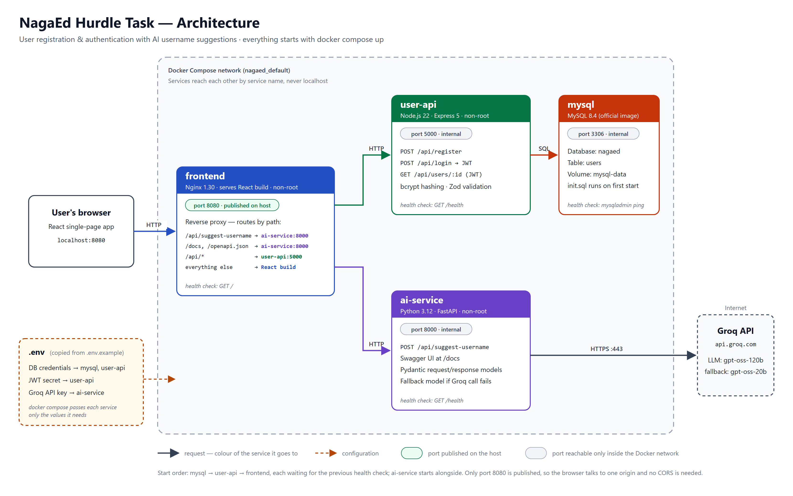

# NagaEd Hurdle Task — User Registration & Authentication

**Sangamlung Gangmei**

Email: ssangamlung@gmail.com · Phone: 8974888433 · LinkedIn: https://www.linkedin.com/in/sangamlung

Repository: https://github.com/syberPawn/nagaed-hurdle-task

A full-stack app where users register, log in and see their profile on a dashboard. While registering, users can pick a few interests and get three AI-generated username suggestions. The whole system starts with one command: `docker compose up`.



| Service | Built with | Port | What it does |
| --- | --- | --- | --- |
| `frontend` | React 19 + Vite, served by Nginx | 8080 (the only port published) | The web app. Nginx forwards `/api/suggest-username` and `/docs` to `ai-service`, and all other `/api/...` requests to `user-api`. |
| `user-api` | Node.js 22, Express 5 | 5000 (internal) | Registration, login (returns a JWT), and fetching the logged-in user's profile. Passwords are hashed with bcrypt. |
| `ai-service` | Python 3.12, FastAPI | 8000 (internal) | Suggests 3 usernames from a list of interests, using an LLM through the Groq API. |
| `mysql` | MySQL 8.4 | 3306 (internal) | Stores users. The `users` table is created automatically on first start. |

## Project structure

```
nagaed-hurdle-task/
├── docker-compose.yml        # Runs all four services
├── .env.example              # Settings template for docker compose
├── architecture.png          # Architecture diagram
├── user-api/                 # Task 1: Node.js REST API
│   ├── app.js                # Express app and startup
│   ├── routes/               # URL → middleware → controller
│   ├── controllers/          # Read the request, send the response
│   ├── services/             # Business logic (hashing, login, access rules)
│   ├── models/               # SQL queries
│   ├── middlewares/          # JWT check, validation, error handling
│   ├── validators/           # Zod request schemas
│   ├── utils/                # JWT helpers, HttpError
│   ├── db.js                 # MySQL connection pool
│   └── sql/init.sql          # users table
├── frontend/                 # Task 2: React app
│   ├── src/api/              # All API calls
│   ├── src/auth/             # Login state, protected routes
│   ├── src/pages/            # Register, Login, Dashboard
│   ├── src/components/       # Form field, username suggestions
│   ├── vite.config.js        # Dev server; forwards /api to the services
│   └── nginx.conf            # Serves the app and forwards /api in Docker
└── ai-service/               # Task 3: FastAPI + Groq
    └── app/
        ├── main.py           # App setup, health check, error handlers
        ├── routers/          # POST /api/suggest-username
        ├── services/         # Prompt, Groq call, fallback model
        ├── schemas.py        # Pydantic request/response models
        └── config.py         # Reads settings from the environment
```

Each service folder also has its own `Dockerfile`, `.dockerignore` and `README.md`. `user-api` and `ai-service` also have a `.env.example` for running without Docker. 

## Run with Docker

### Prerequisites

- [Docker Desktop](https://www.docker.com/products/docker-desktop/) (or Docker Engine with Compose v2), running
- A free Groq API key from [console.groq.com/keys](https://console.groq.com/keys) (no credit card needed)

### 1. Get the code

```bash
git clone https://github.com/syberPawn/nagaed-hurdle-task.git
cd nagaed-hurdle-task
```

### 2. Create the `.env` file

```bash
cp .env.example .env          # macOS / Linux / PowerShell
copy .env.example .env        # Windows Command Prompt
```

Open `.env` and set `GROQ_API_KEY` to your Groq API key. The other values work as they are.

### 3. Start the app

```bash
docker compose up
```

The first run builds the images and takes a few minutes. The app is ready when `frontend-1` logs `start worker process`.

### 4. Use it

| Open | What you get |
| --- | --- |
| http://localhost:8080 | The app. Register (try **Suggest usernames**), log in, and see your dashboard. |
| http://localhost:8080/docs | The AI service's Swagger UI, where you can call `POST /api/suggest-username` directly. |

### Stop

Press `Ctrl+C`, then:

| Command | Effect |
| --- | --- |
| `docker compose down` | Removes the containers. Registered users are kept. |
| `docker compose down -v` | Also deletes the database, for a completely fresh start. |
| `docker compose up --build` | Rebuilds the images. Use this after changing the code. |

## Configuration

All settings live in `.env`.

| Variable | Default | Purpose |
| --- | --- | --- |
| `GROQ_API_KEY` | — | **Required.** Your Groq API key. |
| `GROQ_MODEL` | `openai/gpt-oss-120b` | Groq model used for suggestions. |
| `GROQ_FALLBACK_MODEL` | `openai/gpt-oss-20b` | Model tried if the main one fails. Leave empty to disable. |
| `FRONTEND_PORT` | `8080` | Port the app is served on. |
| `JWT_SECRET` | placeholder | Secret used to sign login tokens. Use a long random value outside local testing. |
| `JWT_EXPIRES_IN` | `1h` | How long a login stays valid. |
| `MYSQL_ROOT_PASSWORD`, `DB_NAME`, `DB_USER`, `DB_PASSWORD` | placeholders | MySQL creates this database and user on first start; `user-api` connects with the same values. |

The database and its user are created only on the first start. To change the `DB_*` or `MYSQL_ROOT_PASSWORD` values afterwards, run `docker compose down -v` to recreate the database. This deletes all registered users.

## Run each service without Docker

Each service can also run on its own for development:

- [`user-api/README.md`](user-api/README.md): Node.js API with a local MySQL
- [`ai-service/README.md`](ai-service/README.md): FastAPI service
- [`frontend/README.md`](frontend/README.md): Vite dev server

## Troubleshooting

| Problem | Fix |
| --- | --- |
| `failed to connect to the docker API` or `Cannot connect to the Docker daemon` | Docker is not running. Start Docker Desktop and wait until it shows "Engine running". |
| `required variable ... is missing a value` | `.env` is missing. Do step 2. |
| `port is already allocated` | Port 8080 is in use. Set `FRONTEND_PORT=8081` in `.env` and open http://localhost:8081. |
| **Suggest usernames** shows "The AI service could not process the request" | `GROQ_API_KEY` is wrong. Fix it in `.env`, then run `docker compose up -d`. Run `docker compose logs ai-service` to see Groq's exact error. |
| `dependency failed to start: container ...user-api-1 is unhealthy`, and `docker compose logs user-api` shows `Access denied` | The `DB_*` values changed after the database was created. Run `docker compose down -v`, then `docker compose up`. |
